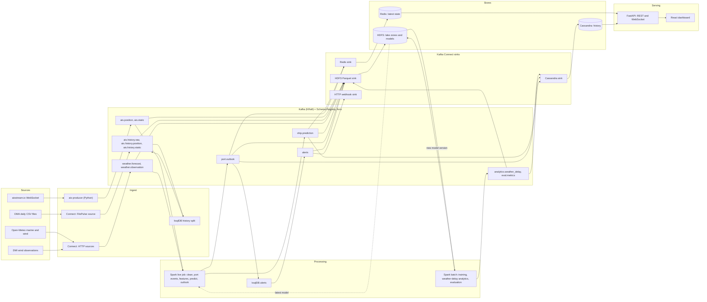

# Architecture

A port operations planner watches a live dashboard. For every ship heading to a port the system
replaces the crew-typed ETA from AIS with a weather-aware predicted ETA and a 70% window, and
rolls the ships up into a port outlook for the next 24 to 48 hours: late ships, arrival bunching
and expected waiting at anchor.

## Data flow



Not drawn: Prometheus scrapes the producer, the API, the Kafka lag exporter and the Spark job;
Grafana reads Prometheus (`infra/monitoring`).

## Design rules

1. **One copy of the feature code.** Cleaning (F4), port event detection (F5) and feature
   building (F6) live only in `spark/common/`. The streaming job and the batch and training jobs
   import it, so a model is trained on exactly the features it sees live.
2. **Replay never touches live state.** Historical data goes through the `ais.history.*` topics.
   Only the HDFS sink reads them. The Redis, Cassandra and webhook connectors list their topics
   explicitly (no patterns), so a history topic cannot reach Redis, the Cassandra outlook tables
   or alerts by accident.
3. **Nothing port-specific in code.** Bounding boxes, zone polygons and weather lookup points are
   in `config/ports.yaml`; thresholds are in `config/thresholds.yaml`. Per-port connector
   instances are generated from the same file (`scripts/render_connectors.py`).
4. **Batch results take the same road as live results.** Batch jobs write to Kafka topics and a
   Connect sink stores them in Cassandra. No component writes to Cassandra directly.
5. **The web tier is stateless.** All state is in Redis and Cassandra, so API instances can be
   added freely. Live push comes from Redis keyspace events (see `connectors.md`).

## Topics

Keys are plain strings (the MMSI or the port id). Values are Avro; the schema of each topic is
`schemas/avro/<topic>.avsc` and is registered as subject `<topic>-value`.

| Topic | Key | Written by | Read by |
|-------|-----|------------|---------|
| `ais.position`, `ais.static` | MMSI | ais-producer | Spark live job, HDFS sink |
| `ais.history.raw` | MMSI | FilePulse connector | ksqlDB history split |
| `ais.history.position`, `ais.history.static` | MMSI | ksqlDB history split | HDFS sink only |
| `weather.forecast` | port | Open-Meteo HTTP connectors | Spark live job, HDFS sink |
| `weather.observation` | port | DMI HTTP connector | Spark, HDFS sink |
| `ship.prediction` | MMSI | Spark live job | Redis, Cassandra and HDFS sinks |
| `port.outlook` | port | Spark live job | ksqlDB alerts, Redis, Cassandra and HDFS sinks |
| `alerts` | port | ksqlDB | webhook and HDFS sinks |
| `analytics.weather_delay`, `eval.metrics` | port | Spark batch jobs | Cassandra and HDFS sinks |

`ais.history.raw` is the one topic beyond the original list. It exists because a DMA CSV row can
hold a position, static data or both, and one connector writes to one topic.

## HDFS

```
/lake/landing        files as downloaded (DMA zips and CSVs)
/lake/raw            Parquet written by the HDFS sink, one folder per topic, hourly partitions
/lake/standardized   cleaned data (output of common/clean.py)
/lake/curated        feature tables for training and evaluation
/lake/quarantine     rows rejected by cleaning, with the reason
/models/eta/v=<UTC timestamp>/   one folder per trained model version
/checkpoints         Spark streaming checkpoints
```

## Cassandra

Keyspace `portcongestion`, defined in `cassandra/schema.cql`: predictions and outlooks partitioned
by `(port, day)`, weather-delay analytics by port, evaluation metrics by `(port, day)`.
